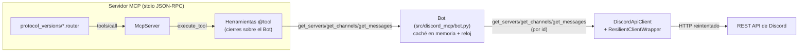
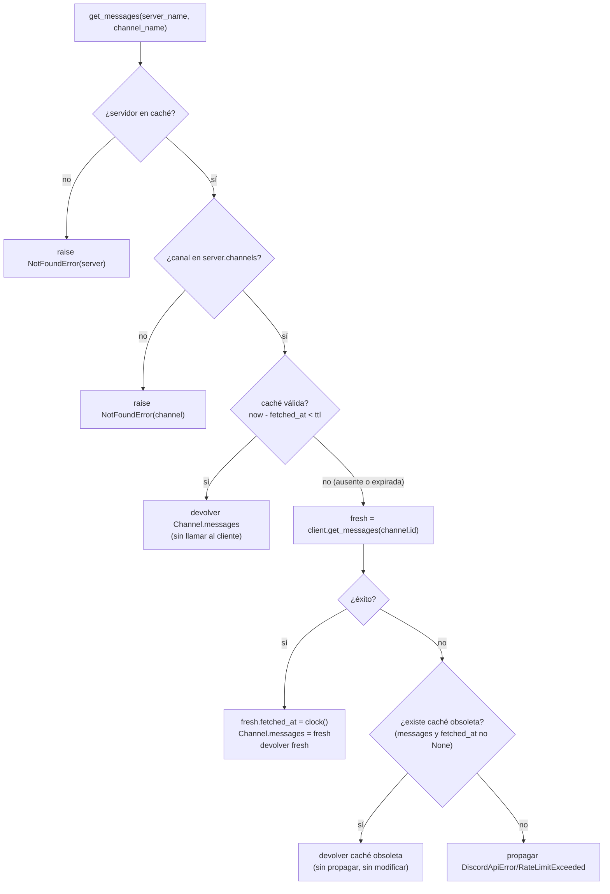

# Design Document — Bot Cache Behavior

## Overview

Este diseño describe el componente `Bot` que actúa como caché en memoria de servidores, canales y mensajes de Discord y que obtiene los datos exclusivamente a través del `DiscordApiClient`. Encaja en el servidor MCP como la capa que las herramientas (`@tool`) consumen: las herramientas identifican servidores y canales por `name`, el `Bot` resuelve `name → id` usando la caché y delega las peticiones HTTP al `DiscordApiClient` (que aporta reintentos, backoff y control de rate-limit).

Objetivos:

- Los servidores y los canales de un servidor se obtienen de la API **una única vez** por sesión y se sirven desde caché en adelante (una lista vacía cuenta como estado poblado).
- Los mensajes se cachean con un **TTL en segundos** y se re-obtienen al expirar; la primera obtención fallida propaga el error, mientras que una re-obtención fallida sirve la caché obsoleta como *fallback*.
- El `DiscordApiClient` se **inyecta por constructor** para permitir tests con un fake sin red.
- No se introducen mecanismos de concurrencia: el servidor es *single-threaded* sobre stdin y atiende a un único cliente a la vez.

## Architecture

El `Bot` es un componente de servicio (no un modelo de datos serializable) que vive en un nuevo módulo `src/discord_mcp/bot.py`. Mantiene la caché anidada en los propios modelos `Server`/`Channel`/`MessageBulk`: los servidores en `Bot._servers`, los canales de un servidor en `Server.channels`, y los mensajes de un canal en `Channel.messages`. El `DiscordApiClient` y un reloj (`clock`) se inyectan por constructor.



Flujo de una petición de mensajes (resumen):



## Components and Interfaces

### Decisión: clase normal (no pydantic) en `src/discord_mcp/bot.py`

El `Bot` que cachea se reconstruye como una **clase normal de Python** (no `pydantic.BaseModel`) en un nuevo módulo `src/discord_mcp/bot.py`, fuera de `models/`.

Justificación:

- Un `DiscordApiClient` contiene internamente un `requests.Session`, que **no es serializable**. Un `BaseModel` pydantic que lo retuviera exigiría `model_config = ConfigDict(arbitrary_types_allowed=True)` y validaciones innecesarias para algo que no es datos, sino un servicio con estado.
- Los modelos `Message`, `MessageBulk`, `Channel` y `Server` **siguen siendo pydantic** en `models/discord_bot.py` (son los datos que se serializan). Solo el componente que cachea deja de serlo.
- La caché se anida en esos modelos (`Server.channels`, `Channel.messages`), que son mutables por defecto en pydantic v2, por lo que no hace falta `frozen`.
- El viejo `Bot` pydantic de `models/discord_bot.py` no se importa en ningún otro módulo del proyecto; se elimina y su helper `get_server_by_name` se reimplanta como resolución privada en el nuevo `Bot`.

### Constructor e inyección de dependencias

```python
# src/discord_mcp/bot.py
from collections.abc import Callable
from datetime import datetime

from discord_mcp.discord_api import DiscordApiClient
from discord_mcp.exceptions import DiscordApiError, NotFoundError, RateLimitExceeded
from discord_mcp.models.discord_bot import Channel, MessageBulk, Server


class Bot:
    """Caché en memoria de servidores, canales y mensajes de Discord.

    Obtiene los datos exclusivamente a través del DiscordApiClient inyectado
    por constructor. Servidores y canales se obtienen una única vez; los
    mensajes se cachean con un TTL (segundos) y se re-obtienen al expirar,
    sirviendo la caché obsoleta como fallback si la re-obtención falla.
    """

    def __init__(
        self,
        discord_client: DiscordApiClient,
        clock: Callable[[], datetime] = datetime.now,
    ):
        self._client = discord_client
        self._clock = clock
        # None  => caché de servidores no poblada.
        # []    => poblada (vacía). Se sirve desde caché sin llamar al cliente.
        self._servers: list[Server] | None = None
```

El `clock` inyectado (por defecto `datetime.now`) es el único origen del "ahora" y del `fetched_at`. Esto hace la lógica de TTL determinista y testeable **sin `monkeypatch`** de `datetime`, en línea con la inyección del `DiscordApiClient`. (Alternativa válida: usar `datetime.now()` directo y hacer `monkeypatch` del `datetime` del módulo en tests; se descarta por ser menos explícita que el reloj inyectado.)

### API pública

| Método | Firma | Comportamiento |
|---|---|---|
| `get_servers` | `() -> list[Server]` | Si `_servers is None`, llama a `client.get_servers()` y puebla. Devuelve la caché. Fallo en primera obtención: propaga. |
| `get_channels` | `(server_name: str) -> list[Channel]` | Resuelve el servidor por nombre; si `server.channels is None`, llama a `client.get_channels(server.id)` y puebla. Devuelve la caché. Servidor no encontrado o fallo en primera obtención: propaga. |
| `get_messages` | `(server_name: str, channel_name: str) -> MessageBulk` | Resuelve servidor y canal por nombre. Si la caché es válida, la devuelve. Si no hay caché válida o expiró, re-obtiene; primera obtención fallida propaga, re-obtención fallida sirve la obsoleta. |

Pseudocódigo:

```python
def get_servers(self) -> list[Server]:
    if self._servers is None:
        self._servers = self._client.get_servers()  # propaga en fallo (6.1)
    return self._servers


def get_channels(self, server_name: str) -> list[Channel]:
    server = self._resolve_server(server_name)
    if server.channels is None:
        # propaga en fallo (6.1); server.channels solo se asigna tras éxito
        server.channels = self._client.get_channels(server.id)
    return server.channels


def get_messages(self, server_name: str, channel_name: str) -> MessageBulk:
    server = self._resolve_server(server_name)
    channel = self._resolve_channel(server, channel_name)

    cached = channel.messages
    if self._is_valid(cached):
        return cached  # acierto de caché: no se invoca al cliente (3.2)

    has_stale = cached is not None and cached.fetched_at is not None
    try:
        fresh = self._client.get_messages(channel.id)
        fresh.fetched_at = self._clock()  # el Bot registra el momento (3.1)
        channel.messages = fresh  # solo tras éxito -> preserva estado en fallo (6.3)
        return fresh
    except (DiscordApiError, RateLimitExceeded):
        if has_stale:
            return cached  # re-fetch fallido: sirve obsoleta (3.5/6.2)
        raise  # primera obtención fallida: propaga (3.4/6.1)
```

Resolución `name → id` (reutilizable para servidor y canal):

```python
def _resolve_server(self, server_name: str) -> Server:
    if self._servers is None:
        raise NotFoundError("server", server_name)
    for server in self._servers:
        if server.name == server_name:
            return server
    raise NotFoundError("server", server_name)


def _resolve_channel(self, server: Server, channel_name: str) -> Channel:
    if server.channels is None:
        raise NotFoundError("channel", channel_name)
    for channel in server.channels:
        if channel.name == channel_name:
            return channel
    raise NotFoundError("channel", channel_name)
```

### Inyección de dependencias: el `Bot` no puebla prerrequisitos

`get_messages` **no** obtiene servidores ni canales automáticamente: resuelve por nombre desde la caché existente. Si la caché de servidores no está poblada, o el canal no está en la caché de canales del servidor, se lanza `NotFoundError`. Por tanto, el orden de uso esperado por una herramienta es `get_servers()` → `get_channels(server_name)` → `get_messages(server_name, channel_name)`. Esto coincide con los criterios 1.3, 2.3 y 3.6.

## TTL Invalidation Logic

La validez de los mensajes en caché se define sobre `MessageBulk.fetched_at` y `MessageBulk.ttl` (por defecto 5):

- **Válida** mientras `now - fetched_at < ttl` (estricto). Se sirve desde caché sin invocar al cliente.
- **Expirada** cuando `now - fetched_at >= ttl` (inclusivo). Se re-obtiene.
- **Sin caché válida** cuando `messages is None` o `fetched_at is None`: primera obtención.

```python
    def _is_valid(self, bulk: MessageBulk | None) -> bool:
        if bulk is None or bulk.fetched_at is None:
            return False
        elapsed = (self._clock() - bulk.fetched_at).total_seconds()
        return elapsed < bulk.ttl
```

Notas:

- `get_messages` del cliente ya fija `fetched_at = datetime.now()`; el `Bot` lo **sobrescribe** con `self._clock()` para que el reloj inyectado sea el único origen tanto del `fetched_at` como del "ahora". En producción ambos usan `datetime.now()` (diferencia despreciable).
- En el *fallback* de re-obtención fallida no se toca `fetched_at` ni `channel.messages`: la caché obsoleta se devuelve tal cual, por lo que la siguiente petición volverá a verla como expirada e intentará re-obtener de nuevo.
- `ttl` se lee del propio `MessageBulk` cacheado (default 5). No se requiere TTL configurable por requisito.

### Cómo se sobreescribe `now` en tests

Se inyecta un reloj falso en el constructor (`clock=lambda: <datetime fijado>` o un reloj mutable tipo "lista de instantes que se van consumiendo"). Así, para simular "capturado en T1, ahora T2":

1. Se llama a `get_messages` con el reloj devolviendo T1 → se obtiene y `fetched_at = T1`.
2. Se avanza el reloj a T2.
3. Se llama de nuevo → la validez se evalúa como `T2 - T1` contra `ttl`.

No hace falta `monkeypatch` del `datetime` del módulo.

## Integration with MCP Server and Tools

### Construcción y *wiring* en `main.py`

El `Bot` se construye en el arranque a partir del `TOKEN` de `config.load_config()` y se inyecta en las herramientas mediante **cierres** (el `@tool` introspecciona signatura + docstring del cierre; `bot` queda como variable libre y no aparece en el esquema).

```python
# src/discord_mcp/main.py
from discord_mcp.bot import Bot
from discord_mcp.config import load_config
from discord_mcp.discord_api import DiscordApiClient
from discord_mcp.discord_tools import register_discord_tools
from discord_mcp.protocol_versions.mcp_2025_11_25 import Mcp20251125
from discord_mcp.protocol_versions.mcp_2026_07_28 import Mcp20260728
from discord_mcp.server import McpServer

DISCORD_API_BASE_URL = "https://discord.com/api/v10"


def build_bot() -> Bot:
    config = load_config()
    client = DiscordApiClient(
        base_url=DISCORD_API_BASE_URL,
        headers={"Authorization": f"Bot {config.bot_token}"},
    )
    return Bot(discord_client=client)


def main():
    server = McpServer()
    server.add_implementation_protocol(Mcp20251125())
    server.add_implementation_protocol(Mcp20260728())

    bot = build_bot()
    register_discord_tools(server, bot)
    server.run()
```

### Herramientas de ejemplo (bosquejo)

Las herramientas delegan en el `Bot` y formatean los modelos a texto para el campo `text` del `content` del router. La implementación completa queda para la fase de tareas.

```python
# src/discord_mcp/discord_tools.py
from discord_mcp.tools import tool


def register_discord_tools(server, bot):
    @tool
    def get_servers() -> str:
        """Lista los servidores (guilds) a los que pertenece el bot."""
        servers = bot.get_servers()
        return ", ".join(f"{s.name} ({s.id})" for s in servers)

    @tool
    def get_channels(server_name: str) -> str:
        """Lista los canales de un servidor.

        Args:
            server_name: Nombre del servidor (guild).
        """
        channels = bot.get_channels(server_name)
        return ", ".join(f"{c.name} ({c.id})" for c in channels)

    @tool
    def get_messages(server_name: str, channel_name: str) -> str:
        """Obtiene los mensajes recientes de un canal.

        Args:
            server_name: Nombre del servidor (guild).
            channel_name: Nombre del canal.
        """
        bulk = bot.get_messages(server_name, channel_name)
        return "\n".join(m.content for m in (bulk.messages or []))

    for t in (get_servers, get_channels, get_messages):
        server.add_tool(t)
```

Propagación de errores al cliente MCP: las excepciones del `Bot` (`NotFoundError`, `DiscordApiError`, `RateLimitExceeded`) se capturan en `Tool.execute` y se reenvuelven en `ToolExecutionError`; el router ya convierte `ToolExecutionError` en un resultado `isError: True`. No hace falta tratamiento especial. (Alternativa equivalente: guardar el `Bot` como atributo de `McpServer` y pasárselo a las herramientas; se descarta por requerir cambiar la firma de ejecución de `@tool`.)

## Data Models

No cambian los modelos pydantic existentes en `src/discord_mcp/models/discord_bot.py`, salvo la **eliminación del viejo `Bot`** (reemplazado por el `Bot` normal de `bot.py`). Se reutilizan tal cual:

```python
class Message(BaseModel):
    content: str


class MessageBulk(BaseModel):
    messages: list[Message] | None = None
    fetched_at: datetime | None = None
    ttl: int = 5


class Channel(BaseModel):
    id: str
    name: str
    messages: MessageBulk | None = None


class Server(BaseModel):
    id: str
    name: str
    channels: list[Channel] | None = None
```

Mapeo de la caché a los modelos:

| Caché | Dónde se almacena | Estado "poblado" | Estado "no poblado" |
|---|---|---|---|
| Servidores | `Bot._servers: list[Server] \| None` | `is not None` (incluso `[]`) | `None` |
| Canales de un servidor | `Server.channels: list[Channel] \| None` | `is not None` (incluso `[]`) | `None` |
| Mensajes de un canal | `Channel.messages: MessageBulk \| None` | `is not None` y `fetched_at is not None` | `None` o `fetched_at is None` |

Al anidar la caché en los propios modelos, los `Server`/`Channel` cacheados son la única fuente de verdad para la resolución `name → id` (ya llevan `id` y `name`).

### Nueva excepción

```python
# src/discord_mcp/exceptions.py  (añadir)
class NotFoundError(Exception):
    def __init__(self, entity: str, name: str):
        self.entity = entity
        self.name = name
        self.message = f"{entity} not found: {name}"
        super().__init__(self.message)
```

Se justifica una nueva excepción porque `ToolNotFoundError` existente es específica de herramientas y no aplica a servidores/canales; `NotFoundError` reutilizable cubre ambos casos de "no encontrado".

## Correctness Properties

*Una propiedad es una característica o comportamiento que debe cumplirse en todas las ejecuciones válidas de un sistema: una afirmación formal sobre lo que el sistema debe hacer. Las propiedades sirven de puente entre las especificaciones legibles y las garantías de corrección verificables por máquina.*

PBT es aplicable: la lógica del `Bot` (aciertos/fallos de caché, TTL, resolución de nombres) es determinista dado un `DiscordApiClient` falso y un reloj inyectado, el comportamiento varía con la entrada y es viable ejecutar 100+ iteraciones con coste bajo. Se usarán fakes (sin red) y un reloj controlable.

### Property 1: Los servidores se obtienen a lo sumo una vez

*Para cualquier* secuencia de llamadas a `bot.get_servers()`, el `get_servers()` del cliente se invoca a lo sumo una vez; tras la primera llamada exitosa, las siguientes devuelven los mismos objetos en caché sin invocar al cliente (una lista vacía cuenta como poblada).

**Validates: Requirements 1.1, 1.2, 4.1, 5.2**

### Property 2: Los canales se obtienen a lo sumo una vez por servidor

*Para cualquier* servidor y *cualquier* secuencia de llamadas a `bot.get_channels(server_name)`, el `get_channels(server.id)` del cliente se invoca a lo sumo una vez para ese servidor; las llamadas siguientes devuelven la caché sin invocar al cliente (una lista vacía cuenta como poblada).

**Validates: Requirements 2.1, 2.2, 4.1, 5.2**

### Property 3: Los mensajes se re-obtienen si y solo si la caché está ausente o expirada

*Para cualquier* canal cacheado, en cualquier instante `now`, `bot.get_messages(server, channel)` invoca al cliente si y solo si no hay caché válida (`messages is None` o `fetched_at is None`) o la caché expiró (`now - fetched_at >= ttl`). Mientras sea válida (`now - fetched_at < ttl`), devuelve la caché sin invocar al cliente. La frontera es estricta en `<` (válida) e inclusiva en `>=` (expirada).

**Validates: Requirements 3.1, 3.2, 3.3, 4.1, 5.2**

### Property 4: La primera obtención de mensajes fallida propaga el error

*Para cualquier* canal sin caché válida, si el `get_messages` del cliente lanza `DiscordApiError` o `RateLimitExceeded`, `bot.get_messages` propaga la excepción (no hay *fallback*, pues no existe caché obsoleta).

**Validates: Requirements 3.4, 6.1**

### Property 5: La re-obtención de mensajes expirada fallida sirve la caché obsoleta

*Para cualquier* canal con caché expirada (`fetched_at` establecido), si la re-obtención lanza `DiscordApiError` o `RateLimitExceeded`, `bot.get_messages` devuelve los mensajes previamente cacheados en lugar de propagar la excepción.

**Validates: Requirements 3.5, 6.2**

### Property 6: La resolución de nombre a id es correcta

*Para cualquier* conjunto de servidores cacheados y *cualquier* nombre, resolver un servidor (o un canal dentro de un servidor) por nombre devuelve la entidad cuyo `name` coincide, y lanza `NotFoundError` cuando no existe coincidencia, incluyendo el caso en que la caché prerrequisito no está poblada.

**Validates: Requirements 1.3, 2.3, 3.6**

### Property 7: El estado de la caché se preserva ante cualquier fallo

*Para cualquier* operación de obtención (servidores, canales o mensajes; primera obtención o re-obtención) que falle, el estado de la caché tras la llamada es idéntico al estado previo: no se escribe ningún dato parcial o incompleto.

**Validates: Requirements 6.3, 6.1**

## Error Handling

`Bot` reutiliza `DiscordApiError` y `RateLimitExceeded` del cliente e introduce `NotFoundError` (servidor/canal no encontrado). Matriz de modos de fallo:

| Operación | Estado caché | Fallo del cliente | Comportamiento |
|---|---|---|---|
| `get_servers` | `_servers is None` | `DiscordApiError` / `RateLimitExceeded` | Propaga; `_servers` queda `None` |
| `get_servers` | `_servers is not None` | (no llama al cliente) | Devuelve caché |
| `get_channels` | servidor no en caché | — | `NotFoundError(server)` |
| `get_channels` | `server.channels is None` | `DiscordApiError` / `RateLimitExceeded` | Propaga; `server.channels` queda `None` |
| `get_channels` | `server.channels is not None` | (no llama al cliente) | Devuelve caché |
| `get_messages` | servidor no en caché | — | `NotFoundError(server)` |
| `get_messages` | canal no en `server.channels` (o canales sin poblar) | — | `NotFoundError(channel)` |
| `get_messages` | sin caché válida (`messages`/`fetched_at` `None`) | `DiscordApiError` / `RateLimitExceeded` | Propaga (primera obtención); caché sin modificar |
| `get_messages` | válida (`now - fetched_at < ttl`) | (no llama al cliente) | Devuelve caché |
| `get_messages` | expirada (`now - fetched_at >= ttl`) | `DiscordApiError` / `RateLimitExceeded` | Devuelve caché obsoleta (*fallback*); caché sin modificar |

Principio de preservación (6.3): `server.channels` y `channel.messages` solo se asignan **tras** una obtención exitosa, por lo que un fallo nunca escribe datos parciales; el estado previo se conserva.

## Testing Strategy

### Enfoque dual

- **Tests de propiedades (PBT)**: verifican las propiedades universales (1–7) con muchas entradas generadas. Biblioteca: **`hypothesis`** (estándar de Python para PBT), que se añade como dependencia de desarrollo (`dev`). No se implementa PBT desde cero. Cada test ejecuta ≥100 iteraciones y se etiqueta `# Feature: bot-cache-behavior, Property N: <texto>`.
- **Tests unitarios/de ejemplo**: cubren casos concretos, integraciones y casos límite; sin red, con fakes.

### Fakes y reloj (sin red)

- `FakeDiscordClient`: registra las llamadas a `get_servers`/`get_channels`/`get_messages` (con los ids recibidos) y permite programar respuestas (listas de `Server`/`Channel`/`MessageBulk`) o excepciones (`DiscordApiError`/`RateLimitExceeded`). Estilo análogo al `ScriptedClient`/`FakeResponse` de `tests/test_client.py`.
- Reloj inyectado: reloj mutable (p. ej., una cola de `datetime` que se consume, o un contador de segundos desde un origen) para controlar tanto `fetched_at` como `now` y ejercitar la frontera del TTL (`<` vs `>=`), incluido el caso `now - fetched_at == ttl`.

### Cobertura por tipo

| Tipo | Qué cubre |
|---|---|
| Property 1 | Servidores: fetch una vez; `[]` como poblada |
| Property 2 | Canales: fetch una vez por servidor; `[]` como poblada |
| Property 3 | Mensajes: re-fetch iff ausente/expirada; frontera TTL estricta/inclusiva |
| Property 4 | Primera obtención de mensajes fallida propaga |
| Property 5 | Re-obtención fallida sirve obsoleta |
| Property 6 | Resolución `name → id` correcta y `NotFoundError` |
| Property 7 | Caché preservada ante cualquier fallo |
| Unit/example | Servidores/canales: primera obtención fallida propaga y caché queda `None` (6.1) |
| Smoke | `Bot` recibe `DiscordApiClient` por constructor (5.1) y delega en el fake (5.2) |
| Smoke | `bot.py` no importa `requests` ni crea `requests.Session` (4.2) |

### Dependencias

- Añadir `hypothesis` al grupo `dev` de `pyproject.toml` y regenerar `uv.lock` (`uv lock`). CI continúa ejecutando `uv run pytest tests`; `ruff` se pasa en local antes de commitear.
