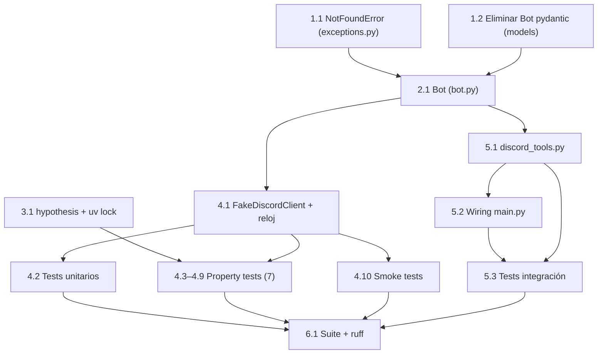

# Implementation Plan: Bot Cache Behavior

## Overview

Implementa el componente `Bot` como caché en memoria de servidores, canales y mensajes de Discord, obtenidos exclusivamente a través del `DiscordApiClient` inyectado por constructor junto con un reloj inyectado. Los servidores y los canales de un servidor se obtienen una única vez por sesión; los mensajes se cachean con un TTL (en segundos) y se re-obtienen al expirar, sirviendo la caché obsoleta como *fallback* cuando la re-obtención falla. El llamador identifica servidores y canales por `name`; el `Bot` resuelve `name → id` desde la caché.

El plan parte de los cambios base (excepción `NotFoundError` y eliminación del viejo `Bot` pydantic), construye `bot.py`, añade `hypothesis` para PBT, crea el `FakeDiscordClient` y los tests (unitarios, 7 propiedades PBT y smoke), y termina con las herramientas MCP (`discord_tools.py`), el wiring en `main.py` y la verificación final. Cada paso deja el repo en estado consistente y se verifica con `uv run pytest` / `uv run ruff`.



## Tasks

- [x] 1. Excepciones y modelos base
  - [x] 1.1 Añadir `NotFoundError` a `exceptions.py`
    - Crear `class NotFoundError(Exception)` con `__init__(self, entity: str, name: str)` que guarde `self.entity`, `self.name` y `self.message = f"{entity} not found: {name}"`, siguiendo el patrón de las excepciones existentes (mensaje en inglés).
    - Reutilizar antes de crear: `ToolNotFoundError` es específica de herramientas, así que se justifica `NotFoundError` reutilizable para servidor/canal.
    - _Design: «Nueva excepción» / Error Handling_
    - _Requirements: 1.3, 2.3, 3.6_
    - Verificar: `uv run ruff check src/discord_mcp/exceptions.py` y `uv run python -c "from discord_mcp.exceptions import NotFoundError; print(NotFoundError('server','x').message)"`

  - [x] 1.2 Eliminar el viejo `Bot` pydantic de `models/discord_bot.py`
    - Borrar `class Bot(BaseModel)` y su `get_server_by_name`; conservar `Message`, `MessageBulk`, `Channel`, `Server` (pydantic v2) tal cual.
    - El viejo `Bot` no se importa en ningún módulo del proyecto, por lo que la eliminación no rompe imports.
    - _Design: «Decisión: clase normal (no pydantic)» / Data Models_
    - Verificar: `uv run ruff check src/discord_mcp/models/discord_bot.py` y `uv run python -c "from discord_mcp.models.discord_bot import Server, Channel, MessageBulk, Message"`

- [x] 2. Implementar el componente `Bot` (`bot.py`)
  - [x] 2.1 Crear `src/discord_mcp/bot.py` con la clase `Bot`
    - Clase normal (no pydantic) con `__init__(self, discord_client: DiscordApiClient, clock: Callable[[], datetime] = datetime.now)`; guardar `self._client`, `self._clock` y `self._servers: list[Server] | None = None`.
    - API pública: `get_servers() -> list[Server]` (puebla `_servers` si es `None`, propaga en fallo), `get_channels(server_name: str) -> list[Channel]` (resuelve el servidor, puebla `server.channels` si es `None`), `get_messages(server_name: str, channel_name: str) -> MessageBulk` (resuelve servidor y canal, sirve la caché válida, re-obtiene si no hay caché válida o expiró, sirve la obsoleta como *fallback* en re-fetch fallido y propaga en primera obtención fallida).
    - Helpers `_resolve_server` / `_resolve_channel` (lanzan `NotFoundError` si la caché prerrequisito no está poblada o no coincide el nombre) y `_is_valid(bulk)` (`False` si `bulk` o `fetched_at` es `None`; `elapsed = (self._clock() - bulk.fetched_at).total_seconds()`; `return elapsed < bulk.ttl`).
    - Asignar `channel.messages`, `server.channels` y `self._servers` solo tras éxito (preserva el estado en fallo, 6.3); sobrescribir `fresh.fetched_at = self._clock()`.
    - Importar únicamente de `discord_api`, `exceptions`, `models/discord_bot`, `collections.abc` y `datetime`. No importar `requests` ni crear `requests.Session` (4.2).
    - _Design: Constructor e inyección, API pública, TTL Invalidation Logic, Error Handling_
    - _Requirements: 1.1, 1.2, 2.1, 2.2, 3.1, 3.2, 3.3, 3.4, 3.5, 3.6, 4.1, 4.2, 5.1, 5.2, 6.1, 6.2, 6.3_
    - Verificar: `uv run ruff check src/discord_mcp/bot.py` y `uv run python -c "from discord_mcp.bot import Bot"`

- [x] 3. Dependencias de test
  - [x] 3.1 Añadir `hypothesis` al grupo `dev` y regenerar `uv.lock`
    - Añadir `"hypothesis"` al grupo `dev` de `pyproject.toml` y ejecutar `uv lock` (dejar `uv.lock` commiteado y sincronizado).
    - _Design: Testing Strategy → Dependencias_
    - Verificar: `uv sync --locked --all-extras --dev` y `uv run python -c "import hypothesis; print(hypothesis.__version__)"`

- [x] 4. Tests del `Bot` (sin red)
  - [x] 4.1 Crear `FakeDiscordClient` y reloj inyectable
    - En `tests/fakes.py`: `FakeDiscordClient` que registra las llamadas a `get_servers` / `get_channels` / `get_messages` (con los ids recibidos) y permite programar respuestas (`list[Server]` / `list[Channel]` / `MessageBulk`) o excepciones (`DiscordApiError` / `RateLimitExceeded`), estilo `ScriptedClient` / `FakeResponse` de `tests/test_client.py`.
    - Reloj mutable inyectable (p. ej. una cola de `datetime` consumible o un `MutableClock` con `now()` / `advance()`) para controlar tanto `fetched_at` como `now` y ejercitar la frontera del TTL (`<` vs `>=`, incluido `now - fetched_at == ttl`).
    - _Design: Testing Strategy → Fakes y reloj_
    - Verificar: `uv run ruff check tests/fakes.py` y `uv run pytest tests -k fakes` (o smoke de importación)

  - [x]* 4.2 Tests unitarios/de ejemplo del `Bot`
    - En `tests/test_bot.py`, con `FakeDiscordClient` + reloj: primera obtención de servidores/canales/mensajes; acierto de caché; expiración y re-fetch; primera obtención fallida propaga (la caché queda `None`); re-fetch fallido sirve la obsoleta; `NotFoundError` de servidor/canal; lista vacía como poblada.
    - _Requirements: 1.1, 1.2, 2.1, 2.2, 3.1, 3.2, 3.3, 3.4, 3.5, 3.6, 6.1, 6.2, 6.3_
    - Verificar: `uv run pytest tests/test_bot.py`

  - [x]* 4.3 Property test: los servidores se obtienen a lo sumo una vez
    - En `tests/test_bot_property_1_servers_once.py` con `hypothesis` (≥100 iteraciones); etiquetar `# Feature: bot-cache-behavior, Property 1: ...`
    - **Property 1: Los servidores se obtienen a lo sumo una vez** — tras la primera llamada exitosa, las siguientes devuelven la caché sin invocar al cliente; `[]` cuenta como poblada.
    - **Validates: Requirements 1.1, 1.2, 4.1, 5.2**
    - Verificar: `uv run pytest tests/test_bot_property_1_servers_once.py`

  - [x]* 4.4 Property test: los canales se obtienen a lo sumo una vez por servidor
    - En `tests/test_bot_property_2_channels_once.py` con `hypothesis`.
    - **Property 2: Los canales se obtienen a lo sumo una vez por servidor** — `get_channels(server.id)` se invoca a lo sumo una vez por servidor; `[]` cuenta como poblada.
    - **Validates: Requirements 2.1, 2.2, 4.1, 5.2**
    - Verificar: `uv run pytest tests/test_bot_property_2_channels_once.py`

  - [x]* 4.5 Property test: los mensajes se re-obtienen iff la caché está ausente o expirada
    - En `tests/test_bot_property_3_messages_refetch.py` con `hypothesis` y reloj controlable.
    - **Property 3: Los mensajes se re-obtienen si y solo si la caché está ausente o expirada** — invoca al cliente iff `messages`/`fetched_at` es `None` o `now - fetched_at >= ttl`; válida mientras `< ttl`. Cubre la frontera `now - fetched_at == ttl`.
    - **Validates: Requirements 3.1, 3.2, 3.3, 4.1, 5.2**
    - Verificar: `uv run pytest tests/test_bot_property_3_messages_refetch.py`

  - [x]* 4.6 Property test: la primera obtención fallida propaga el error
    - En `tests/test_bot_property_4_first_fetch_propagates.py` con `hypothesis`.
    - **Property 4: La primera obtención de mensajes fallida propaga el error** — sin caché válida, si el cliente lanza `DiscordApiError`/`RateLimitExceeded`, `get_messages` propaga (no hay *fallback*).
    - **Validates: Requirements 3.4, 6.1**
    - Verificar: `uv run pytest tests/test_bot_property_4_first_fetch_propagates.py`

  - [x]* 4.7 Property test: la re-obtención fallida sirve la caché obsoleta
    - En `tests/test_bot_property_5_refetch_serves_stale.py` con `hypothesis`.
    - **Property 5: La re-obtención de mensajes expirada fallida sirve la caché obsoleta** — con `fetched_at` establecido, si la re-obtención falla, devuelve los mensajes previos sin propagar.
    - **Validates: Requirements 3.5, 6.2**
    - Verificar: `uv run pytest tests/test_bot_property_5_refetch_serves_stale.py`

  - [x]* 4.8 Property test: la resolución name→id es correcta
    - En `tests/test_bot_property_6_name_resolution.py` con `hypothesis`.
    - **Property 6: La resolución de nombre a id es correcta** — devuelve la entidad cuyo `name` coincide y lanza `NotFoundError` cuando no existe o la caché prerrequisito no está poblada.
    - **Validates: Requirements 1.3, 2.3, 3.6**
    - Verificar: `uv run pytest tests/test_bot_property_6_name_resolution.py`

  - [x]* 4.9 Property test: el estado de la caché se preserva ante cualquier fallo
    - En `tests/test_bot_property_7_cache_preserved.py` con `hypothesis`.
    - **Property 7: El estado de la caché se preserva ante cualquier fallo** — tras cualquier obtención fallida, la caché es idéntica al estado previo (sin datos parciales).
    - **Validates: Requirements 6.3, 6.1**
    - Verificar: `uv run pytest tests/test_bot_property_7_cache_preserved.py`

  - [x]* 4.10 Tests smoke del `Bot`
    - En `tests/test_bot_smoke.py`: `Bot` recibe `DiscordApiClient` por constructor y delega en el fake (5.1/5.2); `bot.py` no importa `requests` ni crea `requests.Session` (4.2) — p. ej. inspeccionando el árbol de imports de `bot.py` con `ast`/`importlib`.
    - _Requirements: 4.2, 5.1, 5.2_
    - Verificar: `uv run pytest tests/test_bot_smoke.py`

- [x] 5. Herramientas MCP y wiring
  - [x] 5.1 Crear `src/discord_mcp/discord_tools.py` con `register_discord_tools`
    - Función `register_discord_tools(server, bot)` que define y registra tres cierres `@tool` (`get_servers`, `get_channels`, `get_messages`) con docstrings estilo Google (primera línea = descripción; sección `Args:` con `name: descripción` por parámetro, obligatorio para `doc_tool_parser`).
    - Los cierres delegan en `bot` (variable libre, no aparece en el esquema) y formatean los modelos a texto para el campo `text` del `content` del router (p. ej. `"name (id)"` para servidores/canales y `"\n".join(m.content ...)` para mensajes).
    - _Design: Integration with MCP Server and Tools → Herramientas de ejemplo_
    - _Requirements: 4.1, 5.1, 5.2_
    - Verificar: `uv run ruff check src/discord_mcp/discord_tools.py` y `uv run python -c "from discord_mcp.discord_tools import register_discord_tools"`

  - [x] 5.2 Conectar el `Bot` en `main.py`
    - Añadir `build_bot()` que lea `config.load_config()`, construya `DiscordApiClient(base_url=DISCORD_API_BASE_URL, headers={"Authorization": f"Bot {config.bot_token}"})` con `DISCORD_API_BASE_URL = "https://discord.com/api/v10"` y devuelva `Bot(discord_client=client)`.
    - En `main()`: tras registrar los protocolos, `bot = build_bot()` y `register_discord_tools(server, bot)` antes de `server.run()`.
    - _Design: Construcción y wiring en main.py_
    - Verificar: `uv run ruff check src/discord_mcp/main.py` y `uv run python -c "from discord_mcp.main import build_bot, main"`

  - [x]* 5.3 Tests de integración de las herramientas
    - En `tests/test_discord_tools.py`: registrar las herramientas en un `McpServer` con un `Bot` respaldado por `FakeDiscordClient` y verificar que `tools/list` expone `get_servers`/`get_channels`/`get_messages` y que `tools/call` devuelve el texto formateado / `isError: True` ante `NotFoundError`/`DiscordApiError`.
    - _Requirements: 4.1, 5.1, 5.2, 6.1_
    - Verificar: `uv run pytest tests/test_discord_tools.py`

- [x] 6. Checkpoint - Suite completa y lint
  - [x] 6.1 Ejecutar la suite completa y el lint
    - Ejecutar `uv run pytest tests`, `uv run ruff check` y `uv run ruff format` (formatear y dejar commiteado). Confirmar que toda la suite pasa y no hay errores de ruff.
    - Verificar: `uv run pytest tests && uv run ruff check && uv run ruff format --check`

## Notes

- Las tareas marcadas con `*` son opcionales (tests) y pueden omitirse para un MVP más rápido; las tareas core (1.1, 1.2, 2.1, 3.1, 4.1, 5.1, 5.2, 6.1) se implementan siempre.
- Cada tarea referencia los requisitos y/o propiedades que cubre para trazabilidad con `requirements.md` y `design.md`.
- Los property tests (4.3–4.9) viven en archivos separados para poder ejecutarse en paralelo sin conflictos de archivo.
- Los tests usan `FakeDiscordClient` + reloj inyectable (sin red ni `monkeypatch` de `datetime`); el `clock` inyectado es el único origen de `fetched_at` y de `now`.
- El CI solo ejecuta `uv run pytest tests`; `ruff` se pasa en local antes de commitear.
- Los checkpoints aseguran validación incremental; ante dudas, preguntar al usuario.

## Task Dependency Graph

```json
{
  "waves": [
    { "id": 0, "tasks": ["1.1", "1.2", "3.1"] },
    { "id": 1, "tasks": ["2.1"] },
    { "id": 2, "tasks": ["4.1", "5.1"] },
    { "id": 3, "tasks": ["4.2", "4.3", "4.4", "4.5", "4.6", "4.7", "4.8", "4.9", "4.10", "5.2"] },
    { "id": 4, "tasks": ["5.3"] },
    { "id": 5, "tasks": ["6.1"] }
  ]
}
```
